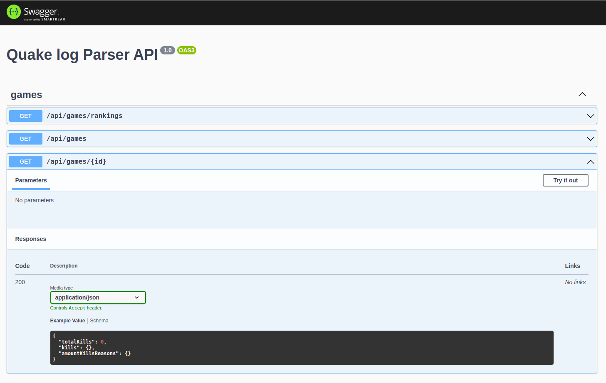
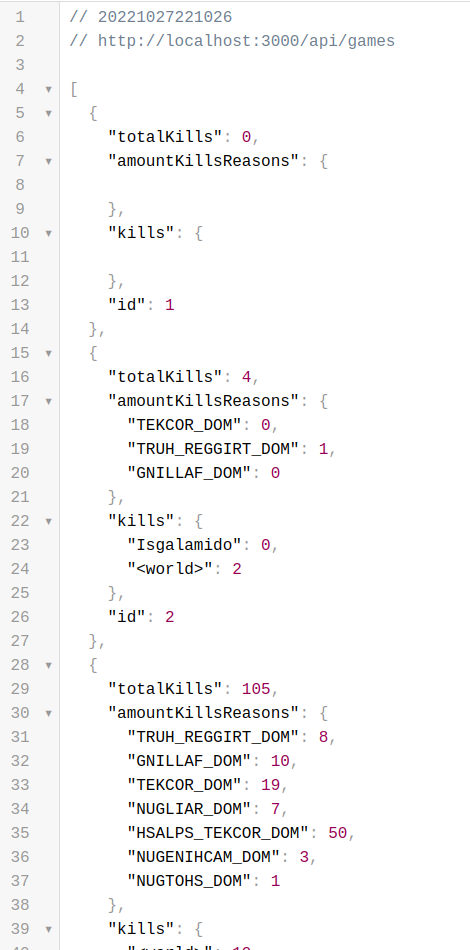
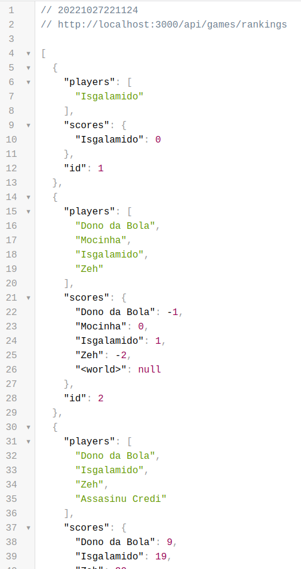

### Para instalar as dependências do projeto

```bash
$ npm install
```

### Rode um build do projeto

```bash
$ npm run build
```

### Para iniciar a aplicação em modo de desenvolvimento

```bash
$ npm run start

# watch mode
$ npm run start:dev

```

### Para rodar a aplicação em modo de produção

```bash
$ npm run start:prod
```

#### Imagens





---


---


